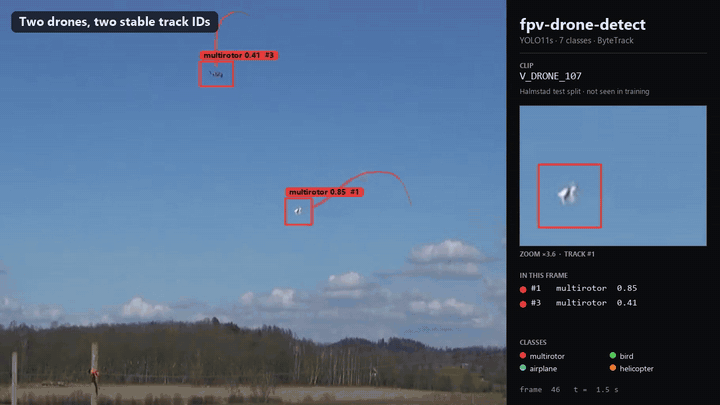

# TrenchView · fpv-drone-detect

### Airspace awareness for the age of drone warfare.

fpv-drone-detect v0.1 on held-out test footage the model never saw during training ·
full 720p video: <a href="https://github.com/y0sHiiiiiiii/fpv-drone-detect/releases/download/v0.1.0/showcase.mp4">showcase.mp4</a>

---

## The sky has changed

War now runs on drones that cost a few hundred dollars. Since 2022, FPV drones have gone from
hobby gear to one of the defining systems on the battlefield, built by the hundreds of thousands
and flown by the thousands every day. The airspace above a modern front line is crowded, cheap
and fast.

The result is an ocean of video. Every flight is recorded, and almost every recording contains
the same hard problem: the object that matters is a 15–30 pixel speck in front of sky, trees or
cloud, and it is in the frame for seconds. People cannot watch every frame, so machines have to.

**TrenchView builds the perception layer for this new airspace: software that finds,
classifies and follows small aerial objects in video, reliably, measurably, and in the open.**

## The product: fpv-drone-detect

`fpv-drone-detect` is our open core. It turns raw video into structured airspace intelligence:

| | |
|---|---|
| **Detect** | finds aerial objects down to a few pixels across, in every frame |
| **Classify** | multirotor, fixed-wing, VTOL, bird, airplane, helicopter, unknown |
| **Track** | one object, one ID, from first frame to last (ByteTrack / BoT-SORT) |
| **Report** | annotated video plus a per-frame JSON log that drops straight into an analysis pipeline |
| **Measure** | every model ships with mAP, per-class precision/recall, size-binned metrics and MOTA/IDF1 on video |

Under the hood: YOLO11 fine-tuned at 1280 px, a custom stride-4 detection head for the smallest
targets, SAHI tiling for high-resolution footage, and suppression of the oversized second
boxes that small objects attract.

**Built to tell drones from everything else.** Birds, airliners and helicopters are first-class
classes, not afterthoughts. A system that calls every crow a threat is a system nobody trusts.

## Performance

v0.1, benchmarked on 45 held-out videos that the model never saw in training:

| Metric | v0.1 |
|---|---|
| Detection accuracy (mAP@0.5) | **0.847** |
| Drone precision / recall on video | **0.89 / 0.91** |
| Drone tracking (MOTA / IDF1) | **0.77 / 0.83** |
| Airplanes or helicopters mistaken for a drone | **0** across all held-out aircraft clips |

We publish what does not work yet, too: boxes on the very smallest drones are too large,
airliners are sometimes confused with helicopters, and upscaling at inference time made results
worse. Every experiment, good or bad, is written up in [`docs/experiments/`](docs/experiments/).

*v0.1 is trained on the public Halmstad dataset, static ground cameras in Sweden. It has not yet
seen front-line FPV footage, and the numbers above should not be read as if it had.*

## Principles

**We build eyes, not weapons.** Our software analyses recorded video. That is a deliberate
product decision, not a limitation we plan to remove:

- **Offline by design.** Recorded video in, annotations out. No live feeds, no on-board
  deployment.
- **No hardware integration.** No cameras, flight controllers, gimbals, sensors or MAVLink.
- **No targeting.** No control, guidance, interception or actuation logic, ever.
- **No attribution.** We do not identify specific military models, manufacturers or units, and
  we do not geolocate footage or people.
- **Clean data.** Public research datasets with clear licenses. No scraping, and no footage of
  identifiable people or casualties.

Contributions that cross these lines are declined.

## What's next

- **v0.2: small-target head.** The stride-4 detection head is in training and aims at the size
  bias on the smallest drones.
- **Real-world footage.** An FPV test set with motion blur, ground clutter and moving cameras.
- **More data.** Additional public datasets beyond Halmstad.

The detailed plan is in [ROADMAP.md](ROADMAP.md).

## Get started

Installation, data preparation, training, evaluation, video inference and the full results
tables are in the **[Developer guide](docs/GUIDE.md)**. To contribute, see
[CONTRIBUTING.md](CONTRIBUTING.md).

## Citation

If fpv-drone-detect is useful for your work, please cite it (see [CITATION.cff](CITATION.cff)) and
the dataset it was trained on: F. Svanström, F. Alonso-Fernandez, C. Englund, "A dataset for
multi-sensor drone detection", *Data in Brief* 39 (2021), doi:10.1016/j.dib.2021.107521.

## License

The code is licensed under [AGPL-3.0](LICENSE), matching Ultralytics, on which it builds. The
Halmstad dataset is CC0-1.0, and the showcase GIF and video show frames from it.
