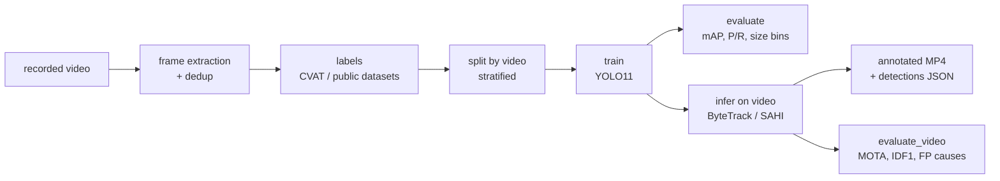

# fpv-drone-detect · Developer guide

Everything you need to run the pipeline yourself: setup, data preparation, training,
evaluation, video inference, results and the repository layout. Back to the
[README](../README.md).

**Contents:** [Pipeline](#pipeline) · [Quick start](#quick-start) · [Classes](#classes) · [Setup](#setup) · [Data preparation](#data-preparation) · [Training and evaluation](#training-and-evaluation) · [Video inference and tracking](#video-inference-and-tracking) · [Results](#results) · [Repository layout](#repository-layout) · [Showcase video](#showcase-video) · [Checks](#checks) · [Roadmap](#roadmap)

## Pipeline



## Quick start

```bash
git clone https://github.com/y0sHiiiiiiii/fpv-drone-detect && cd fpv-drone-detect
python -m venv .venv && source .venv/bin/activate
pip install torch torchvision --index-url https://download.pytorch.org/whl/cu126   # or /cpu
pip install -r requirements.txt -r requirements-dev.txt

# detect + track in your own recording (weights: train your own, see below)
python scripts/infer_video.py --weights best.pt --source my_clip.mp4 --output out/
```

Output: `out/my_clip_annotated.mp4`, `out/my_clip_detections.json` (per frame: track ID, class,
confidence, box) and `out/my_clip_tracks.csv`. Trained weights are not distributed. Train them
on the public Halmstad dataset with the commands below (~3.6 h on an RTX 4070 SUPER).

## Classes

| ID | Name | Meaning |
|----|------|---------|
| 0 | `multirotor` | quad/hexa/octocopter, incl. FPV quads |
| 1 | `fixed_wing` | fixed-wing drones |
| 2 | `vtol` | hybrids with rotors and wings |
| 3 | `bird` | negative class against false positives |
| 4 | `unknown_aerial` | aerial object, not clearly assignable |
| 5 | `airplane` | manned fixed-wing aircraft |
| 6 | `helicopter` | manned rotorcraft with a main rotor |

Classes 5 and 6 exist since 2026-10-15. Models trained before that (`baseline`) know only
classes 0–4.

## Setup

Requires Python 3.11+ and FFmpeg.

```bash
python -m venv .venv
source .venv/bin/activate            # Windows PowerShell: .venv\Scripts\Activate.ps1

# GPU: install a CUDA build of PyTorch first, or pip installs the CPU-only build
pip install torch torchvision --index-url https://download.pytorch.org/whl/cu126

pip install -r requirements.txt -r requirements-dev.txt
```

If the repo lives in a synced folder (Nextcloud, Dropbox, …), exclude `.venv/`, `data/` and
`runs/` from syncing, or create the venv outside the repo.

## Data preparation

Put videos into `data/raw/` manually, or use public research datasets. There are no download tools.
Add every source to `sources/sources.csv` with its license.

```bash
# 1. sample frames -> data/frames/<video_id>/<video_id>_f000123.jpg
python scripts/extract_frames.py --input data/raw/ --output data/frames/ --fps 5

# 2. move near-duplicate consecutive frames to data/frames/_duplicates/ (try --dry-run first)
python scripts/dedupe_frames.py --input data/frames/ --threshold 0.95

# 3. annotate (CVAT / Label Studio), export YOLO to data/labeled/{images,labels}/

# 4. split by video -> data/splits/{train,val,test}.txt + split_manifest.csv
python scripts/split_dataset.py --by video --ratios 0.7 0.15 0.15
```

Frame names must follow `<video_id>_fNNNNNN.<ext>`, because the video id in the name is how
`split_dataset.py` keeps every video in a single split. By default it also stratifies by each
video's dominant class, so every split gets a similar class mix. It validates all labels and warns
if the training set's background share (frames without objects) falls outside 10–20 %.

### Public datasets

**Halmstad drone detection dataset** (CC0-1.0, [GitHub](https://github.com/DroneDetectionThesis/Drone-detection-dataset),
[Zenodo](https://doi.org/10.5281/zenodo.5500576)): download and unpack it to `data/raw/halmstad/`, then run

```bash
python scripts/convert_halmstad.py            # visible videos, 5 fps -> data/labeled/images/halmstad/...
python scripts/visualize_labels.py --subdir halmstad --class bird   # check boxes in data/qa/
python scripts/split_dataset.py
```

The class mapping lives in `configs/sources/halmstad.yaml`: drone → `multirotor`, bird → `bird`,
airplane → `airplane`, helicopter → `helicopter`. The MATLAB `groundTruth` label files are read by
`fpvdd.matlab_gt`, a small MAT5 parser that handles any number of boxes per frame.

Almost every Halmstad frame contains a labeled object, so background images are cut from the
frames (`options.background_crops`): every 6th sampled frame yields one crop of 70, 60 or 50 % of
the frame side that keeps 16 px away from all labeled boxes. Crops are named
`<video_id>_fNNNNNN_bg.jpg` and keep their clip's video id, so they stay in its split.
`--bg-every 0` turns them off.

Result with the defaults: 285 clips → 14,984 frames plus 2,029 background crops (12.0 %
background); 6,098 multirotor, 3,652 bird, 3,121 airplane and 3,288 helicopter boxes.

## Training and evaluation

```bash
python scripts/train.py --smoke                 # 1 epoch on 5 % of the data, checks the setup
python scripts/train.py --name baseline7        # configs/train.yaml: yolo11s, imgsz 1280, 40 epochs
python scripts/train.py --set epochs=50 model=yolo11m.pt --name m50   # any Ultralytics override
python scripts/train.py --set model=configs/models/yolo11s-p2.yaml pretrained=yolo11s.pt \n    epochs=25 --name p2                          # extra stride-4 head for tiny objects
python scripts/train.py --resume runs/detect/baseline   # continue an interrupted run
```

On the RTX 4070 SUPER, training at `imgsz=1280` runs at ~37 images/s (autobatch picks 4; the first
epoch is slower while Windows starts the dataloader workers). On the 7-class data that is ~5.3 min
per epoch, ~3.6 h for 40 epochs. Progress per epoch is in `runs/detect/<name>/results.csv`.

`train.py` wraps the Ultralytics trainer. It resolves all paths against the repo root, checks the
split lists first, and keeps downloaded weights in `runs/weights/`. It uses project-local
Ultralytics settings in `runs/.ultralytics/`, so your global Ultralytics settings (e.g. another
project's `weights_dir`) are neither used nor changed. `--smoke` trains on random subsets: Ultralytics'
`fraction` takes the alphabetically first images, which here are whole clips of one class. Each run directory gets an
`fpvdd_run.json` with the git commit, a dataset fingerprint (hash of split membership and label
contents), the resolved config, package versions, GPU and the final validation metrics.
W&B logging is Ultralytics' built-in integration: `pip install wandb` and `yolo settings wandb=True`.

Plain Ultralytics works too, run from the repo root:
`yolo detect train cfg=configs/train.yaml`.

```bash
python scripts/evaluate.py --weights runs/detect/baseline/weights/best.pt --split test
python scripts/evaluate.py --weights ... --limit 200     # quick check on a random subset
```

`evaluate.py` writes `runs/eval/<run>_<split>/report.md` and `metrics.json` with:
- mAP@0.5 and mAP@0.5:0.95 from Ultralytics and from pycocotools
- per-class AP, plus precision/recall both at Ultralytics' best-F1 confidence and at a fixed
  operating point (`--op-conf 0.25`, IoU ≥ 0.5)
- AP per class and object size (COCO: small < 32², medium < 96², large, in original pixels)
- a confusion matrix at the operating point, with multirotor ↔ bird spelled out. Ultralytics'
  own matrix uses conf 0.001 and is dominated by low-confidence boxes.
- checks that no video appears in two splits and that the dataset matches the training run
- COCO ground truth and predictions as JSON for error analysis

Don't evaluate on the GPU while a training run uses it: two models at `imgsz=1280` overflow
the 12 GB VRAM and Windows falls back to very slow shared memory. Use `--device cpu` meanwhile.

## Video inference and tracking

```bash
python scripts/infer_video.py --weights runs/detect/baseline/weights/best.pt     --source input.mp4 --tracker bytetrack.yaml --output out/
python scripts/infer_video.py --weights ... --source videos/ --sahi --slice 640   # small objects
python scripts/infer_video.py --weights ... --source a.mp4 b.mp4 --tracker none   # detection only
```

For each video, `infer_video.py` writes the following to `--output` (default `runs/infer/`):
- `<name>_annotated.mp4`: boxes with class, confidence and track ID. Boxes smaller than 8 px are
  drawn enlarged so tiny objects stay visible. With FFmpeg on the PATH the video is H.264,
  otherwise MPEG-4 Part 2 (plays in VLC).
- `<name>_detections.json`: one entry per frame, `{"frame", "timestamp_s", "detections":
  [{"track_id", "class", "confidence", "bbox_xyxy"}]}`, with boxes in pixels of the source video
- `<name>_tracks.csv`: one row per track (lifetime, majority class, mean confidence, box size)
- `infer_run.json`: the settings, the git commit and a summary per video

How it works: every frame goes through the detector, either the full frame or, with `--sahi`,
overlapping slices (SAHI, plus one full-frame pass for objects cut by slice borders). The boxes
then go into an Ultralytics tracker (ByteTrack or BoT-SORT, configured by their YAML files). Both
detection modes use the same tracking path. Defaults that differ from Ultralytics:
- NMS IoU 0.5 instead of 0.7, plus containment suppression (`--ios 0.8`, 0 turns it off). The
  suppression drops a box that lies at least 80 % inside a box with higher confidence. On small
  drones the model often adds a second, larger box around the tight one, and their IoU stays
  below any useful NMS threshold. On the test videos it cuts the drone tracks from 45 to 31.
  Details are in [docs/experiments/2026-10-11_video_tracking.md](experiments/2026-10-11_video_tracking.md).
- the confidence floor is 0.1 with a tracker, as in Ultralytics' track mode, because ByteTrack
  uses low-confidence boxes to continue tracks. Without a tracker it is 0.25.
- SAHI slices are fed to the model at the training `imgsz` (`--slice-imgsz`). The baseline was
  trained on 640×512 frames upscaled to 1280, so 640 px slices see objects at the training scale.

BoT-SORT's ReID with `model: auto` needs hooks inside Ultralytics' predictor, which this script
does not use, so it is rejected. ByteTrack and BoT-SORT without ReID work.

### Evaluating video output

`evaluate_video.py` compares the output of `infer_video.py` with per-frame ground truth. It
currently supports Halmstad, which labels every frame:

```bash
python scripts/evaluate_video.py --pred runs/infer/baseline_test
python scripts/evaluate_video.py --pred runs/infer/baseline_test --iou 0.3 \
    --output runs/infer/baseline_test/video_eval_iou03
```

It writes `report.md`, `metrics.json` and `per_video.csv` to `<pred>/video_eval/`:
- precision / recall / F1 per clip type and per class
- false positives by kind: wrong class, duplicate box, localization (IoU 0.1 up to the
  threshold), another labeled object (e.g. an airplane), background
- MOTA, IDF1, ID switches, fragmentation, false tracks and tracks per object
- the videos to look at first

Matching is class-aware and one-to-one per frame. As in CLEAR MOT, an object keeps its previous
track while that track still overlaps it enough. Halmstad has no object ids, so identity metrics
only cover clips with at most one object of our classes per frame. The script warns if a video
comes from the training or validation split.

## Results

Halmstad is a static ground camera filming against mostly sky backgrounds, so these numbers say
little about FPV footage yet.

### 7 classes (current)

Test split of the 7-class data: 2,575 images from 45 videos never seen in training (968
multirotor, 568 bird, 472 airplane, 525 helicopter boxes; 9.4 % background crops).

| Model | Data | imgsz | mAP@0.5 | mAP@0.5:0.95 | multirotor AP50 | bird AP50 | airplane AP50 | helicopter AP50 | P / R multirotor @0.25 | P / R bird @0.25 |
|---|---|---|---|---|---|---|---|---|---|---|
| yolo11s (`baseline7`, epoch 21) | Halmstad visible, 7 classes | 1280 | 0.847 | 0.415 | 0.881 | 0.753 | 0.888 | 0.866 | 0.75 / 0.91 | 0.67 / 0.69 |

Video with tracking (ByteTrack, all 45 test videos at the full frame rate, IoU 0.5):

| Model | drones P / R | drones MOTA / IDF1 | birds P / R | airplanes P / R | helicopters P / R | multirotor tracks on aircraft clips |
|---|---|---|---|---|---|---|
| `baseline7` | 0.89 / 0.91 | 0.77 / 0.83 | 0.89 / 0.69 | 0.63 / 0.74 | 0.94 / 0.91 | 0 |

Write-up: [docs/experiments/2026-10-15_baseline7.md](experiments/2026-10-15_baseline7.md).
Reports: `runs/eval/baseline7_test/report.md`, `runs/infer/baseline7_test/video_eval/report.md`.

- No airplane or helicopter is detected as multirotor anymore (0 of 997 boxes on single images,
  no multirotor track on any aircraft clip). The remaining aircraft errors are confusions among
  airplane, helicopter and bird: 52 airplanes are detected as helicopter, and 45 aircraft as bird.
- On the 12 test videos that both models never trained on, `baseline7` beats the old baseline on
  drones (MOTA 0.72 → 0.78, IDF1 0.85 → 0.87) and on bird recall (0.57 → 0.71).
- The box size bias on drones shrinks a little (median area ratio 1.33 → 1.16 at 15–30 px), but the
  mean IoU stays the same. Localization is still the main source of drone false positives.
- Validation mAP peaked at epoch 21 and then declined. 25 epochs are enough for this data.
- Some false bird tracks are lens dirt: specks that stay at the same pixel while the camera moves.

### 5 classes (old baseline, old split)

Test split of the 5-class data: 1,615 frames from 44 videos (916 multirotor and 518 bird boxes).
Not comparable with the table above: only 12 test videos are shared, and the old model saw the
other 33 videos of the new test split during training or validation.

| Model | Data | imgsz | mAP@0.5 | mAP@0.5:0.95 | multirotor AP50 | bird AP50 | P / R multirotor @0.25 | P / R bird @0.25 |
|---|---|---|---|---|---|---|---|---|
| yolo11s (`baseline`, epoch 29) | Halmstad visible, 5 classes | 1280 | 0.777 | 0.347 | 0.802 | 0.751 | 0.52 / 0.87 | 0.81 / 0.73 |
| same weights, NMS IoU 0.5 | | 1280 | 0.781 | 0.334 | 0.794 | 0.767 | 0.74 / 0.84 | 0.84 / 0.73 |

mAP and AP values are Ultralytics'. P/R are measured at conf 0.25 and IoU ≥ 0.5. Write-ups:
[baseline](experiments/2026-10-11_baseline.md),
[video tracking](experiments/2026-10-11_video_tracking.md).

- Most multirotor false positives were a second box or an offset box on a drone the model had
  already found. With NMS IoU 0.5 instead of 0.7, multirotor precision at conf 0.25 rises from
  0.52 to 0.74 (video inference uses 0.5).
- On video, drones reached P/R 0.82 / 0.82, MOTA 0.64 and IDF1 0.79 at IoU 0.5, and 0.97 / 0.98 at
  IoU 0.3: the boxes on tiny objects are too large (size bias).
- Airplanes, then dropped as negatives, produced long false `multirotor` tracks on video.
- Validation mAP peaked at epoch 29 of 100 (overfitting). Training took 6.1 h.
- Higher resolution at inference only does not help: with `--imgsz 1920` drone MOTA drops from
  0.64 to 0.54, with SAHI (320 px slices) to 0.45. Write-up:
  [docs/experiments/2026-10-15_resolution_test.md](experiments/2026-10-15_resolution_test.md).

## Repository layout

```
configs/        dataset.yaml, train.yaml, showcase.yaml
configs/sources/  per-dataset class mapping and options
configs/models/   custom model definitions (yolo11-p2.yaml)
data/           raw/, frames/, labeled/, splits/  (gitignored, never commit)
sources/        sources.csv  (url, license, date_accessed, notes)
scripts/        extract_frames.py, dedupe_frames.py, split_dataset.py,
                convert_halmstad.py, visualize_labels.py, train.py, evaluate.py,
                infer_video.py, evaluate_video.py, make_showcase.py
src/fpvdd/      shared helpers (naming, labels, video, dedupe, split, sources,
                matlab_gt, halmstad, draw, evaluation, inference, video_eval)
docs/experiments/  one write-up per experiment (setup, results, analysis)
docs/media/     README showcase GIF (the only committed media)
notebooks/      error analysis (planned)
tests/          pytest tests
```

## Showcase video

```bash
python scripts/make_showcase.py --gif     # clips and texts in configs/showcase.yaml
```

Renders a 720p MP4 (`runs/showcase/showcase.mp4`) from existing `infer_video.py` output: boxes,
track IDs and trails on the video, plus a side panel with a magnified view of the main track.
No model runs, so it works on the CPU while the GPU trains. `--gif` also writes the README GIF
(`docs/media/showcase.gif`).

## Checks

```bash
pytest
ruff check . && ruff format --check .
```

## Roadmap

Details, decisions and open questions are in [ROADMAP.md](../ROADMAP.md).

1. ✅ Scaffolding and data prep (extract, dedupe, split by video) with tests
2. ✅ Public dataset ingestion (Halmstad) with class mapping and label QA visualisation
3. ✅ Baseline training (`scripts/train.py`, yolo11s @ 1280)
4. ✅ Evaluation: mAP@0.5 / 0.5:0.95, per-class P/R, confusion matrix, small/medium/large breakdown
5. ✅ Video inference with ByteTrack/BoT-SORT and optional SAHI → annotated MP4 + detections JSON
6. 🚧 Error analysis and iteration: video tracking metrics, 7 classes with background crops,
   resolution test done; P2 detection head training; error analysis notebook next
